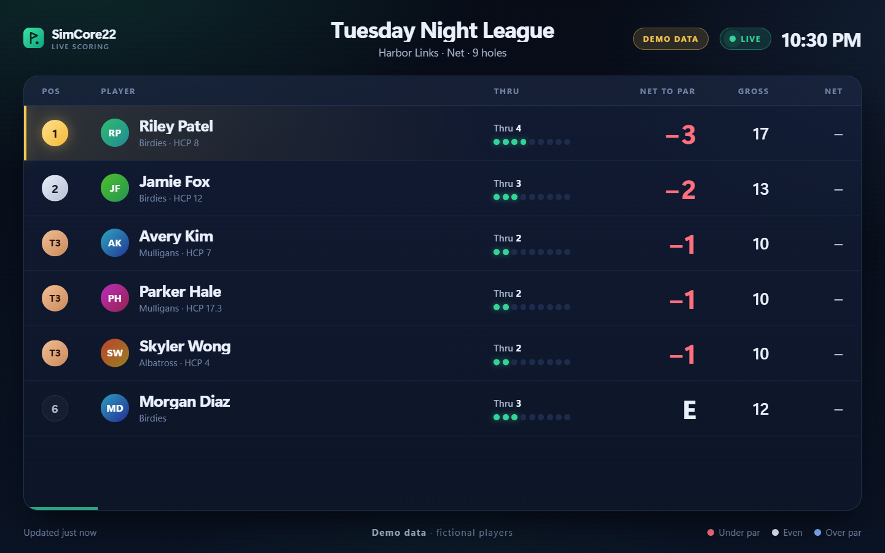
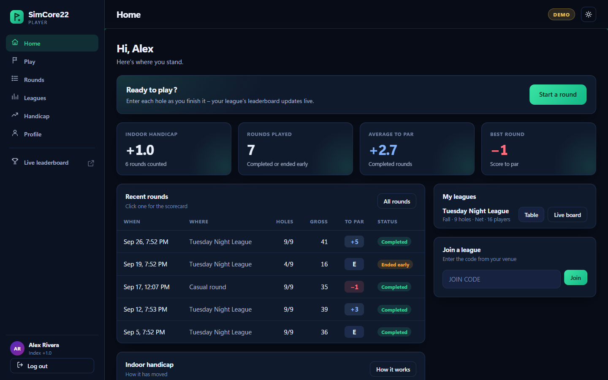
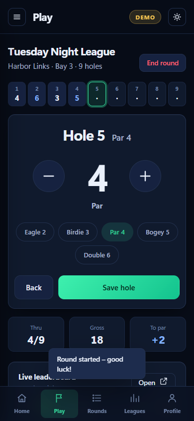
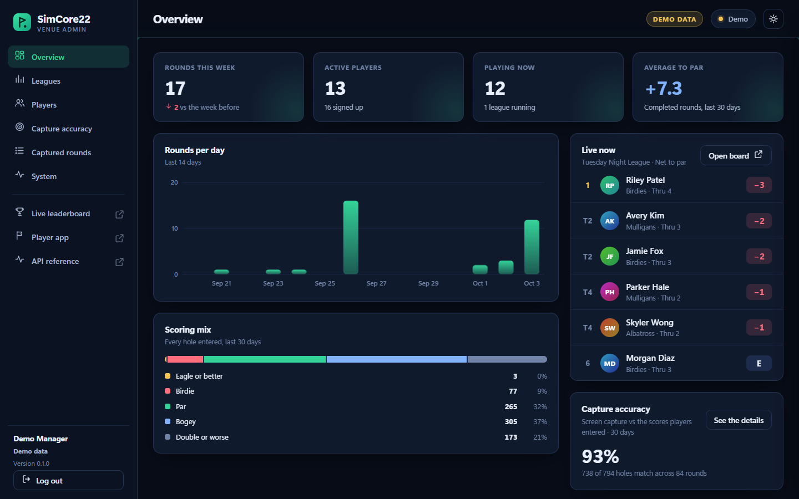
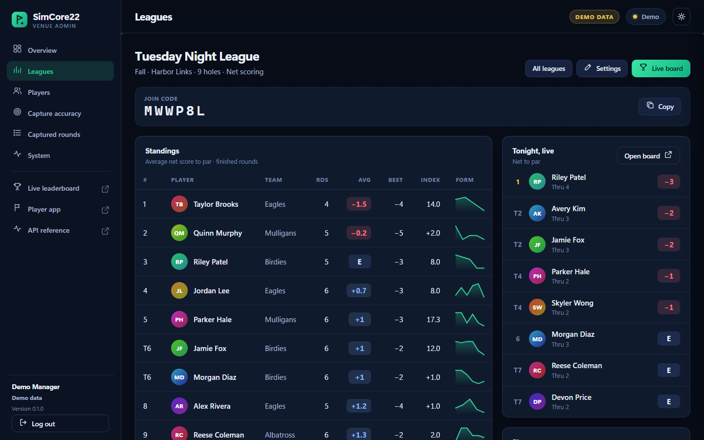
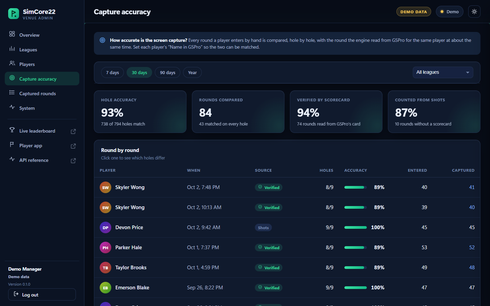
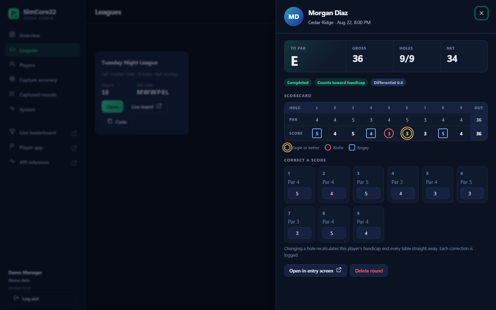

# SimCore22

An all-in-one system for indoor golf venues: players log in and enter their rounds hole by
hole (or, as it matures, have them read from GSPro and launch monitors automatically), and it
keeps indoor handicaps, league standings and live leaderboards on every bay. Windows, Python
3.12+ (developed on 3.14).

> **Status: proof of concept.** Everything below is built and tested without
> hardware. The first run on a real bay (Foresight Falcon / Hawk + GSPro) is
> the next milestone - see [Status](#status).

<p align="center">
  
</p>
<p align="center"><sub>The live leaderboard for bay screens. (Screenshots show the built-in <b>demo league</b>: fictional players, not real data.)</sub></p>

**Try it without a bay:** double-click `run_demo.bat` (or run `python -m simcore22.web --demo`).

## Status

| Area | State |
|---|---|
| Capture the GSPro window (any size / position / monitor) | built, tested on stand-in windows |
| Read GSPro's scorecard, verified against its printed totals | built; works on the one real 18-hole card; 9-hole layout is an **assumption** |
| Round lifecycle: ends on GSPro's scorecard, quit / save any time | built, tested |
| Append-only round log with the scorecard screenshot of every round | built, tested |
| Leaderboard / round summary / admin snapshot JSON | built, tested |
| Live player and hole tracking from the HUD | needs calibration on a bay |
| Live shot data (ball speed, carry, ...) | **not working yet** - needs real launch-monitor packets (`packet_capture`) |
| Handicap updates | engine built; leagues (schedule, round numbers) not configurable yet |
| Live leaderboard for bay screens + venue admin portal (web UI) | built, tested; works on demo data today and on real rounds as soon as there are some |
| Player accounts, log-in, hole-by-hole round entry by hand, indoor handicap, league tables, live board per league | built, tested in a real browser on demo data - **not yet tried at a real venue** |
| Capture-accuracy check (screen capture vs what players typed in) | built, tested; becomes meaningful once capture runs on a real bay |
| Outdoor GHIN number / index | collected at sign-up, **self-reported - not verified** (needs GHIN / USGA access) |
| POS, bay & lesson scheduling, payments | not started |

## How it works

```
Launch-monitor feed (optional, off) ───────┐
GSPro screen capture + OCR  ───────────────┼─► EventDispatcher ─► engine ─► leaderboard
   - player / hole tracking                                          │        handicap
   - end-of-round scorecard ─► rounds (finish / save / reset)        │        analyzer
                                                                     ├─► state/*.json      (live, overwritten)
                                                                     └─► data/rounds.jsonl (permanent log)
```

Until there is official API access, reading GSPro's screen is the bridge. When a
real data feed exists it plugs in as one more event source; nothing downstream
changes.

The launch-monitor feed is **off by default**: its protocol is a placeholder, and
GSPro's own port (921) must never be connected to - GSPro accepts a single
client, so the engine would take FSX's place. Turn the feed on only after
`packet_capture` has found the launch monitor's real port
(`SIMCORE_FEED_PORT`); the engine refuses port 921.

## Players, leagues and manual entry

Until screen capture is proven on a real bay, **players enter their own rounds, hole by
hole**, and everything else builds on that: the live leaderboard, season standings, the
indoor handicap and the admin tables all update the moment a hole is saved. When capture
works it can run alongside - and every hand-entered round becomes an answer key for
checking it.

<p align="center">
  
  
</p>

- **Sign up / log in** (`/login`): name, email, password, and - optionally - the player's
  **outdoor GHIN number and handicap index** plus their name in GSPro. The GHIN number and
  index are **on the player's honour**: there is no GHIN check yet. The outdoor index gives a
  new player a fair starting handicap until they have a few simulator rounds.
- **Enter a round** (`/app`, built for phones): pick the league (or a casual 9 / 18), then
  step through each hole - big +/- stepper, one-tap Eagle / Birdie / Par / Bogey / Double.
  End a round early any time: what's entered is kept and counts toward the handicap from
  9 holes. Players fix their own mistakes for a day; after that only an admin can.
- **Indoor handicap, "SimCore Index v1"**: modelled on the World Handicap System - each round
  becomes a differential (blow-up holes capped at net double bogey, scaled to 18 holes), the
  index is the average of the best differentials of the last 20, and the outdoor index is
  blended in until a player has three rounds. It is a simulator handicap, **not** an official
  or GHIN handicap, and is rebuilt from the whole history whenever a round is corrected.
- **Leagues**: an admin creates a league (course, pars, 9 / 18 holes, net or gross ranking);
  players join with a six-character code. The league table ranks by average score to par;
  net scores use each player's index at the start of the round.
- **Bay screens** (`/live?league=ID`): each screen shows one league's board and remembers it.
  `/live?source=capture` shows the screen-capture board instead.
- **Is the capture right?** Admin -> *Capture accuracy* pairs every hand-entered round with the
  round the engine read for the same player at about the same time, hole by hole: overall
  accuracy, verified-vs-counted-from-shots, which holes differ, and rounds with no partner.
  Set each player's "Name in GSPro" so the two can be matched.

Accounts live in `data/simcore22.db` (SQLite - one file, easy to back up; git-ignored).
Passwords are hashed with scrypt, sessions use an HttpOnly cookie, log-ins are throttled,
every state-changing request needs an anti-forgery header, and admin actions are logged.
There is no email, so a forgotten password is reset by the front desk (admin page, or
`python -m simcore22.league reset-password --email ...`). The first admin is created from
the venue PC itself (`/admin` asks on first visit) or with
`python -m simcore22.league create-admin --email ... --name ...`.

> **Before real players use this over a network:** the server speaks plain http. Keep it on the
> venue network, and put https in front of it (a reverse proxy or tunnel) before exposing it
> further. Player emails and GHIN numbers are personal data.

## Web UI

<p align="center">
  
  
</p>
<p align="center">
  
  
</p>

| Screen | Where | What it's for |
|---|---|---|
| **Player app** | `/app` | Home, enter a round, rounds and scorecards, league tables, handicap and how it works, profile. Phone first, desktop too |
| **Live leaderboard** | `/live` | Put it on every bay TV: big type, glides when someone moves up, flashes on a new score, pages through long fields. Press `F` for full screen. No login - it is what the screens show |
| **Admin portal** | `/admin` | **Overview**, **Leagues** (create, join code, standings, live board, members and teams, every round - click to correct a score), **Players** (accounts, handicaps, reset password, roles, disable), **Capture accuracy**, **Captured rounds** (what the engine read from GSPro, with the scorecard screenshot), **System** (is the engine running, can it see GSPro, with the fix when it can't). Light and dark themes |
| **API** | `/docs` | Every number the screens show, as JSON with interactive documentation |

```bash
python -m simcore22.web            # your venue
python -m simcore22.web --demo     # a fictional venue with accounts, history and a live night (everything labelled DEMO)
```

`run_ui.bat` / `run_demo.bat` do the same with a double-click, and `run_bay.bat`
starts the UI together with the engine. The demo's log-in page has one-click buttons for the
fictional manager and players; nothing in the demo is saved. Set `SIMCORE_LEAGUE_NAME` to
title the *screen-capture* board. It listens on this PC only by default; for phones and
screens on other PCs use `--host 0.0.0.0` (see the note above about https). Nothing is loaded
from the internet, so it works offline.

## Where does GSPro's own round data go?

Honest answer, from the public material found so far: GSPro shows the scorecard and keeps the
round in memory while you play, but there is **no documented export of scored rounds** (its CSV
export covers practice-range sessions; online tournament rounds go to the SimGolf Tour cloud),
and its Open Connect interface carries shots *into* GSPro, not scores out. One competitor
(RoundBoss) ships a Windows "bridge" that streams hole scores from GSPro - unofficial, how it
works isn't published, and it can break when GSPro updates. So today the choices are:
screen capture (what this project does), hand entry (above), or **asking GSPro for a data /
partner API** - which a working product with real league data makes much easier to ask for.
Worth checking on a bay: whether GSPro writes any round or log files under its install folder,
Documents or AppData.

## Set up a bay PC (once)

Double-click **`setup_bay.bat`**. It installs Python 3.14 and Tesseract
(via winget), creates `.venv`, installs `requirements.txt`, and runs the
diagnostic. Then **`run_bay.bat`** starts the web UI and the engine.

## How a round works

GSPro shows its scorecard when the chosen number of holes (9, 18, any) is
finished - never mid-round. The engine watches for that screen (the one with
the **PLAY AGAIN!** button), reads it, and finishes the round. A scorecard
without that button is treated as a mid-round peek and ignored.

| How it ended | Status | Handicap can change? |
|---|---|---|
| End-of-round scorecard appears | `completed` | yes (league rounds) |
| Someone types `end` in the engine window | `ended_early` | no |
| No activity for 20 min (`SIMCORE_IDLE_MINUTES`) | `abandoned` | no |
| Someone types `save` | `snapshot` (round continues) | no |

Every way keeps all data and stats; a hole left unfinished when someone quits
is kept but not counted as a score. Then the next round starts clean
(handicaps and the current player carry over). Type `help` in the engine
window for the commands: `end`, `save`, `status`.

Scores come from GSPro's scorecard where it **adds up** (each player's holes
checked against the printed OUT / IN totals); otherwise from our shot count.
The scorecard also adds players the live tracking missed, so a round is still
recorded if HUD tracking never worked.

## Round log

Every finished round is appended to `data/rounds.jsonl` - one line per player
per round: status, hole-by-hole scores, where the scores came from
(`scorecard_ocr_verified` = GSPro's own scorecard, `shot_tally` = our shot
count), every shot captured, the stats, and the raw scorecard reading. Each
end-of-round scorecard screenshot is kept in `data/scorecards/` so any logged
round can be checked against what GSPro showed. A `snapshot` line shares its
`round_id` with the round's final line - use the latest line per `round_id`.
The log is append-only, survives restarts, and is git-ignored (it holds player
names). It is not a database - it's the evidence for deciding what the
database should store. Read it with `simcore22.engine.round_log.read_rounds()`.

## Screen capture

The engine captures the GSPro **window**, cropped to its picture (no title
bar, borders, or position on screen involved), so GSPro doesn't need to fill
the display. Requirements:

- GSPro must be **Windowed or Borderless**, not exclusive fullscreen
  (exclusive fullscreen captures as black; the engine logs a warning if so).
- Keep GSPro on top of its monitor - other windows covering it show up in
  the capture.
- GSPro's window title must contain `GSPro`. If it doesn't, set the
  `SIMCORE_WINDOW_TITLE` environment variable. `bay_check` lists real titles.

## Tools

Run from the project folder, e.g. `.venv\Scripts\python -m simcore22.tools.bay_check`.

| Tool | What it's for |
|---|---|
| `simcore22.web` | The web UI: player app, live leaderboard, admin portal, API (see above). `--demo` for the fictional venue |
| `simcore22.league` | Account tasks from the command line: `create-admin`, `reset-password`, `list-users` |
| `simcore22.tools.ui_screenshots` | Regenerate `docs/images/` from the demo (needs Playwright + Edge, dev only) |
| `simcore22.tools.bay_check` | What's running, what the capture sees, a verdict. Saves `captures/<time>/` (screenshots, `report.json`) - send that folder back when something looks wrong |
| `simcore22.tools.packet_capture` | Record what a launch monitor / simulator really sends (hex dump file) so it can be decoded |
| `simcore22.tools.capture_screenshot` | Save one frame of the GSPro picture |
| `simcore22.tools.ocr_calibration` | Draw the HUD regions on that frame and save them as the OCR layout |
| `simcore22.tools.fake_round_feed` | Demo data with no hardware, for developing a leaderboard screen |
| `simcore22.tools.diagnostic_dashboard` | Live "is data flowing / are the files updating" board |
| `simcore22.ui.live_leaderboard`, `round_summary`, `admin_view` | Console viewers for `state/*.json` (see `examples/state/` for the file shapes) |

## Project layout

- `simcore22/engine/engine_loop.py` - entry point; connects sources → engine → outputs
- `simcore22/engine/rounds.py` - round lifecycle: when it ends, what's saved, what carries over
- `simcore22/engine/scorecard_watch.py`, `console.py`, `publish.py` - spotting the end-of-round
  card, typed commands, standings → screens
- `simcore22/engine/engine.py` - live session state (players, holes, handicaps)
- `simcore22/engine/ocr/` - window capture, scorecard reader, HUD reading
  (`layouts/*.json` are fractions of the game picture)
- `simcore22/engine/ingestion/` - event bus; Foresight and TrackMan parsers (placeholders)
- `simcore22/engine/{leaderboard,analyzer,handicap,scheduling,models,admin}/` - scoring
- `simcore22/engine/round_log.py`, `state_writer.py` - the permanent log, the live JSON
- `simcore22/league/` - accounts, hand-entered rounds, the indoor handicap, standings, the
  capture-accuracy check (SQLite; `demo_seed.py` builds the fictional venue)
- `simcore22/web/` - the web UI: `app.py` (pages, live stream, wiring), `league_api.py` (accounts /
  leagues / rounds API), `auth.py` (cookies, anti-forgery), `data.py` (engine round log -> what the
  screens show), `demo.py` (fictional capture data), `static/` (HTML / CSS / JS, no build step)
- `simcore22/tools/`, `simcore22/ui/` - diagnostics and console viewers
- `examples/` - sample output files
- `tests/` - `python -m pytest`

## Developing

```bash
.venv\Scripts\python -m pip install -r requirements-dev.txt
.venv\Scripts\python -m pytest
.venv\Scripts\ruff check simcore22 tests
```

Generated folders (`state/`, `data/`, `logs/`, `captures/`) are git-ignored.
